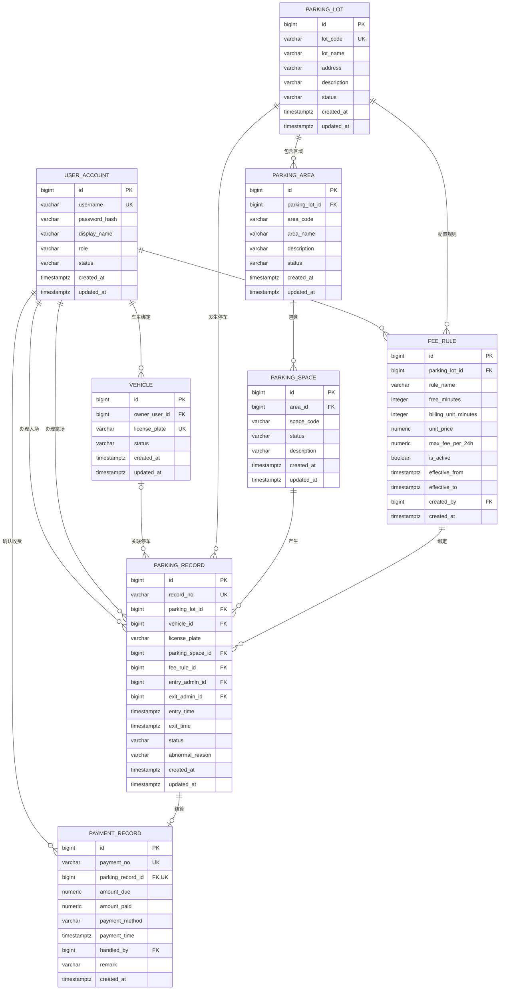

# 智能停车场管理系统 ER 图

> 项目：`smart-parking-system`  
> 设计分支：`docs/database-design`  
> 数据库：PostgreSQL  
> 最后更新：2026-11-11
> 依据文档：[智能停车场管理系统需求分析](../智能停车场管理系统_需求分析.md)

## 1. 设计范围

本课程设计支持管理多个停车场，只支持普通小型汽车，系统包含管理员和车主两类用户。数据库设计包含以下 8 个核心实体：

1. 用户账号 `user_account`
2. 车辆 `vehicle`
3. 停车场 `parking_lot`
4. 停车区域 `parking_area`
5. 停车位 `parking_space`
6. 收费规则 `fee_rule`
7. 停车记录 `parking_record`
8. 收费记录 `payment_record`

管理员之间不区分操作员等岗位，所有管理员都能管理全部停车场。车主只能绑定本人车辆并查看本人车辆在各停车场产生的记录，不能访问停车场管理功能。

## 2. 关键设计决定

### 2.1 建立停车场表

系统需要管理多个停车场，因此建立 `parking_lot` 表。停车区域、收费规则和停车记录都必须明确所属停车场，自动分配车位、查询和统计必须限定停车场范围。

为了控制课程设计规模，不建立管理员与停车场的授权关联表；所有 `ADMIN` 账号均可管理全部停车场。

### 2.2 管理员和车主共用账号表

管理员与车主都需要用户名、密码摘要、显示姓名和账号状态，因此统一使用 `user_account` 表，通过 `role` 区分 `ADMIN` 与 `OWNER`。这样无需维护两套登录逻辑。

角色权限由后端接口校验：

- `ADMIN` 可以管理停车场基础数据、办理入场离场、收费和查看全部记录。
- `OWNER` 只能管理本人车辆并查看本人车辆的记录。

### 2.3 建立车辆表，同时允许临时车辆

`vehicle` 保存车牌号码及所属车主。一名车主可以绑定多辆车，同一车牌只能绑定给一名车主。

停车场仍允许未注册、未绑定的临时车辆入场：

- 已绑定车辆入场时，`parking_record.vehicle_id` 关联车辆。
- 临时车辆入场时，`parking_record.vehicle_id` 为 `NULL`。
- 无论是否绑定车辆，`parking_record.license_plate` 都保存入场时的车牌快照。

这样既支持车主查看本人记录，也不会要求所有来访车辆必须先注册。

### 2.4 停车记录直接保存停车场编号

虽然可以通过“停车记录 → 停车位 → 停车区域”推导停车场，但多停车场系统的大量查询、统计和权限判断都以停车场为条件，因此 `parking_record` 直接保存 `parking_lot_id`。后端在办理入场的同一事务中校验停车场、停车位和收费规则归属一致，避免冗余字段产生矛盾。

### 2.5 不建立车位类型表

需求已经确定不区分普通车位、充电车位等车位类型，因此 `parking_space` 不包含车位类型字段，也不建立车位类型表。

### 2.6 停车记录绑定收费规则

车辆入场时，将当时生效的收费规则编号保存到停车记录中。以后修改收费规则时，不会改变已有停车记录所使用的规则。

### 2.7 收费记录与停车记录一对一

一条停车记录最多对应一条收费记录。停车中的记录尚未收费，因此可以没有收费记录；完成正常支付或免费放行后，才创建收费记录。

### 2.8 停车位保存当前状态

`parking_space.status` 保存车位当前状态，便于快速显示空闲数、占用数和停用数。车辆入场和离场时，停车记录与车位状态必须在同一个数据库事务中更新。

## 3. 实体关系

| 主实体 | 关系 | 从实体 | 说明 |
| --- | --- | --- | --- |
| `user_account` | 1 对多 | `vehicle` | 一个车主账号可以绑定多辆车，一辆车只属于一个车主 |
| `vehicle` | 1 对多 | `parking_record` | 一辆已绑定车辆可以产生多条历史停车记录；临时车辆的关联为空 |
| `parking_lot` | 1 对多 | `parking_area` | 一个停车场包含多个停车区域 |
| `parking_lot` | 1 对多 | `fee_rule` | 每个停车场独立维护收费规则 |
| `parking_lot` | 1 对多 | `parking_record` | 一个停车场可以产生多条停车记录 |
| `parking_area` | 1 对多 | `parking_space` | 一个停车区域包含多个停车位 |
| `parking_space` | 1 对多 | `parking_record` | 一个停车位可以产生多条历史停车记录 |
| `fee_rule` | 1 对多 | `parking_record` | 一条收费规则可以被多条停车记录绑定 |
| `parking_record` | 1 对 0 或 1 | `payment_record` | 停车中的记录没有收费记录，结算后最多有一条 |
| `user_account` | 1 对多 | `parking_record` | 管理员办理车辆入场和离场 |
| `user_account` | 1 对多 | `fee_rule` | 管理员创建收费规则 |
| `user_account` | 1 对多 | `payment_record` | 管理员确认收费或免费放行 |

## 4. ER 图

GitHub 可以直接渲染下面的 Mermaid ER 图。

## 5. 关系说明

### 5.1 用户账号与车辆

- `vehicle.owner_user_id` 外键引用 `user_account.id`。
- 一个 `OWNER` 账号可以绑定多辆车，同一车辆只能属于一个车主。
- 数据库外键只能保证账号存在；“所属账号必须是 `OWNER`”由后端业务校验。
- 同一车牌不能重复绑定。
- 有历史记录的车辆不物理删除，只能将状态改为 `DISABLED`。
- `ADMIN` 账号不能使用车主车辆绑定功能。

### 5.2 车辆与停车记录

- `parking_record.vehicle_id` 可空，外键引用 `vehicle.id`。
- 已绑定且启用的车辆入场时自动写入 `vehicle_id`。
- 未绑定的临时车辆仍可入场，此时 `vehicle_id` 为 `NULL`。
- `parking_record.license_plate` 始终保存入场时的车牌快照，不依赖车辆表展示历史车牌。
- 车主查看记录时，后端通过当前账号、车辆归属和停车记录关联限制查询范围。

### 5.3 停车场与停车区域

- `parking_area.parking_lot_id` 外键引用 `parking_lot.id`。
- 一个停车场可以包含多个停车区域，一个区域只能属于一个停车场。
- `area_code` 在同一停车场内唯一，不同停车场可以重复使用 `A`、`B` 等区域编号。
- 停车场存在区域或历史记录时不物理删除，只允许停用。
- 停用停车场前必须确保该停车场没有正在停车的车辆。

### 5.4 停车区域与停车位

- `parking_space.area_id` 外键引用 `parking_area.id`。
- 同一区域内的 `space_code` 不能重复。
- 区域下存在停车位时，不允许物理删除区域。
- 自动分配车位时，只选择启用区域中的 `FREE` 车位。

### 5.5 停车位与停车记录

- `parking_record.parking_space_id` 外键引用 `parking_space.id`。
- 同一个停车位可以对应多条历史记录。
- 同一停车位同时最多存在一条状态为 `PARKING` 的记录。
- 有历史停车记录的停车位不物理删除，只允许停用。

### 5.6 停车场、收费规则与停车记录

- `fee_rule.parking_lot_id` 外键引用 `parking_lot.id`。
- 每个停车场独立维护收费规则，同一停车场同一时刻最多一条当前有效规则。
- `parking_record.parking_lot_id` 外键引用 `parking_lot.id`。
- `parking_record.fee_rule_id` 外键引用 `fee_rule.id`。
- 车辆入场时绑定所选停车场当前有效的收费规则。
- 停车记录、停车位和收费规则必须属于同一个停车场，该跨表规则由后端事务校验。
- 已经被停车记录引用的收费规则不得物理删除或直接修改计费参数。
- 修改价格时应新增收费规则，并停用旧规则。

### 5.7 停车记录与收费记录

- `payment_record.parking_record_id` 外键引用 `parking_record.id`。
- `payment_record.parking_record_id` 具有唯一约束，保证一条停车记录最多有一条收费记录。
- 停车状态为 `PARKING` 时不能创建最终收费记录。
- 正常完成的停车记录必须存在对应收费记录。

### 5.8 管理员与业务记录

- `parking_record.entry_admin_id` 记录办理入场的 `ADMIN` 账号。
- `parking_record.exit_admin_id` 记录办理离场的 `ADMIN` 账号，停车中可以为空。
- `fee_rule.created_by` 记录收费规则创建人。
- `payment_record.handled_by` 记录收费确认或免费放行的管理员。
- 数据库外键只能保证账号存在；这些字段必须关联 `ADMIN` 角色由后端校验。
- 已经产生业务记录的账号不物理删除，只允许停用。

## 6. 状态与角色定义

### 6.1 用户角色

| 数据库存储值 | 中文含义 |
| --- | --- |
| `ADMIN` | 管理员，拥有停车场管理权限 |
| `OWNER` | 车主，只能管理本人车辆并查看本人记录 |

### 6.2 用户账号状态

| 数据库存储值 | 中文含义 |
| --- | --- |
| `ACTIVE` | 正常，可以登录 |
| `DISABLED` | 停用，不允许登录 |

### 6.3 车辆状态

| 数据库存储值 | 中文含义 |
| --- | --- |
| `ACTIVE` | 正常绑定，可自动关联新的停车记录 |
| `DISABLED` | 停用绑定，保留历史数据但不再自动关联新记录 |

### 6.4 停车场状态

| 数据库存储值 | 中文含义 |
| --- | --- |
| `ACTIVE` | 启用，可以新增业务并参与车位分配 |
| `DISABLED` | 停用，不允许办理新的车辆入场 |

### 6.5 停车区域状态

| 数据库存储值 | 中文含义 |
| --- | --- |
| `ACTIVE` | 启用，可以参与车位分配 |
| `DISABLED` | 停用，不参与车位分配 |

### 6.6 停车位状态

| 数据库存储值 | 中文含义 |
| --- | --- |
| `FREE` | 空闲，可以分配 |
| `OCCUPIED` | 占用，当前有车辆停放 |
| `DISABLED` | 停用，不能分配 |

### 6.7 停车记录状态

| 数据库存储值 | 中文含义 |
| --- | --- |
| `PARKING` | 停车中，已经入场但尚未离场 |
| `COMPLETED` | 已完成，已经收费并正常离场 |
| `ABNORMAL` | 异常结束，由管理员处理并填写原因 |

### 6.8 支付方式

| 数据库存储值 | 中文含义 |
| --- | --- |
| `CASH` | 现金 |
| `ELECTRONIC` | 模拟电子支付，不接入真实支付平台 |
| `FREE_RELEASE` | 免费放行，实收金额必须为 0 并填写原因 |

## 7. 核心完整性规则

### 7.1 可以由数据库直接保证

- 用户名唯一。
- 用户角色和账号状态只能从规定集合中选择。
- 车辆车牌号码唯一。
- 停车场编号唯一。
- 同一停车场内区域编号唯一。
- 同一区域内停车位编号唯一。
- 停车记录编号唯一。
- 收费记录编号唯一。
- 一条停车记录最多对应一条收费记录。
- 同一车牌同一时刻最多一条 `PARKING` 记录。
- 同一停车位同一时刻最多一条 `PARKING` 记录。
- 金额和时间参数不能为负数。
- 离场时间不能早于入场时间。
- 各类状态值只能从规定集合中选择。

### 7.2 需要由后端事务与数据库共同保证

- 车主只能操作 `owner_user_id` 为本人账号的车辆。
- 车主只能查询本人车辆所关联的停车记录。
- `vehicle.owner_user_id` 必须指向 `OWNER` 角色账号。
- 入场、离场、收费和规则管理字段必须指向 `ADMIN` 角色账号。
- 自动分配、入场、收费规则、记录查询和统计必须限定停车场范围。
- 停车记录、停车位和收费规则必须属于同一个停车场。
- 已绑定车辆入场时自动关联车辆，临时车辆允许 `vehicle_id` 为空。
- 入场时同时创建停车记录并将车位从 `FREE` 改为 `OCCUPIED`。
- 离场时同时更新停车记录、创建收费记录并将车位从 `OCCUPIED` 改为 `FREE`。
- 只能分配启用区域中的空闲车位。
- 占用中的车位不能停用。
- 正常离场前必须完成支付确认。
- 每个停车场同一时刻只能有一条有效收费规则。
- 免费放行必须由管理员填写原因。

## 8. 删除策略

| 数据 | 删除策略 |
| --- | --- |
| 用户账号 | 有车辆或业务记录后不物理删除，改为 `DISABLED` |
| 车辆 | 有历史记录后不物理删除，改为 `DISABLED` |
| 停车场 | 存在区域或历史记录时禁止删除，改为 `DISABLED` |
| 停车区域 | 存在停车位时禁止删除，改为 `DISABLED` |
| 停车位 | 有历史记录后不物理删除，改为 `DISABLED` |
| 收费规则 | 被停车记录引用后禁止删除，改为非当前有效 |
| 停车记录 | 业务历史数据，不提供物理删除功能 |
| 收费记录 | 财务历史数据，不提供物理删除功能 |

所有业务外键默认采用限制删除策略，避免级联删除历史数据。

## 9. 统计与查询数据来源

系统不额外建立统计结果表，首页和统计页面通过核心业务表实时聚合：

| 统计或查询内容 | 数据来源 |
| --- | --- |
| 停车场列表 | `parking_lot` |
| 全部或指定停车场总车位数 | `parking_lot` → `parking_area` → `parking_space` |
| 空闲、占用、停用数量 | 按停车场范围和 `parking_space.status` 分组 |
| 车位占用率 | 占用车位数 ÷ 可使用车位数 |
| 在场车辆数 | `parking_record.status = 'PARKING'` |
| 指定日期入场数 | 按 `parking_record.parking_lot_id`、`entry_time` 统计 |
| 指定日期离场数 | 按 `parking_record.parking_lot_id`、`exit_time` 统计 |
| 指定时间范围收入 | 通过停车记录所属停车场汇总 `payment_record.amount_paid` |
| 车主的车辆 | 按 `vehicle.owner_user_id` 查询 |
| 车主的停车记录 | 当前账号 → `vehicle` → `parking_record` |

可使用车位数定义为 `FREE` 与 `OCCUPIED` 数量之和，停用车位不计入占用率分母。

## 10. 下一步

1. 全组三人评审本文和《数据字典》。
2. 确认多停车场归属、账号角色、车辆绑定、临时车辆和数据权限方案。
3. 评审通过后编写 `database/01_schema.sql`。
4. 编写 `database/02_seed_data.sql`，提供管理员、车主、车辆、至少两个停车场及其区域、停车位和默认收费规则。
5. 在空的 `smart_parking` 数据库中重复执行并验证初始化脚本。
