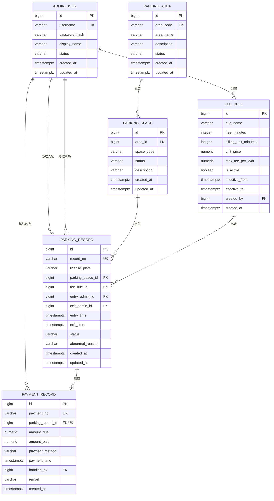

# 智能停车场管理系统 ER 图

> 项目：`smart-parking-system`  
> 设计分支：`docs/database-design`  
> 数据库：PostgreSQL  
> 编写日期：2026-10-27  
> 依据文档：[智能停车场管理系统需求分析](../智能停车场管理系统_需求分析.md)

## 1. 设计范围

本课程设计只管理一个停车场，只支持普通小型汽车，并且只设置管理员角色。数据库设计包含以下 6 个核心实体：

1. 管理员 `admin_user`
2. 停车区域 `parking_area`
3. 停车位 `parking_space`
4. 收费规则 `fee_rule`
5. 停车记录 `parking_record`
6. 收费记录 `payment_record`

## 2. 关键设计决定

### 2.1 不建立停车场表

系统只管理一个停车场，不存在多停车场之间的数据隔离和切换，因此不建立 `parking_lot` 表。停车区域直接作为停车位的上级实体。

### 2.2 不建立车辆表

本课程设计不管理车主、车辆型号、会员资料等长期车辆信息，只需要记录每次停车时的车牌号码。单独建立只有车牌字段的车辆表不能提供实际业务价值，因此车牌号码直接保存在 `parking_record` 中。

同一车牌可以产生多条历史停车记录，但通过 PostgreSQL 部分唯一索引保证同一时刻最多只有一条状态为 `PARKING` 的记录。

### 2.3 不建立车位类型表

需求已经确定不区分普通车位、充电车位等车位类型，因此 `parking_space` 不包含车位类型字段，也不建立车位类型表。

### 2.4 停车记录绑定收费规则

车辆入场时，将当时生效的收费规则编号保存到停车记录中。以后修改收费规则时，不会改变已有停车记录所使用的规则。

### 2.5 收费记录与停车记录一对一

一条停车记录最多对应一条收费记录。停车中的记录尚未收费，因此可以没有收费记录；完成正常支付或免费放行后，才创建收费记录。

### 2.6 停车位保存当前状态

`parking_space.status` 保存车位当前状态，便于快速显示空闲数、占用数和停用数。车辆入场和离场时，停车记录与车位状态必须在同一个数据库事务中更新。

## 3. 实体关系

| 主实体 | 关系 | 从实体 | 说明 |
| --- | --- | --- | --- |
| `parking_area` | 1 对多 | `parking_space` | 一个停车区域包含多个停车位 |
| `parking_space` | 1 对多 | `parking_record` | 一个停车位可以产生多条历史停车记录 |
| `fee_rule` | 1 对多 | `parking_record` | 一条收费规则可以被多条停车记录绑定 |
| `parking_record` | 1 对 0 或 1 | `payment_record` | 停车中的记录没有收费记录，结算后最多有一条 |
| `admin_user` | 1 对多 | `parking_record` | 管理员办理车辆入场和离场 |
| `admin_user` | 1 对多 | `fee_rule` | 管理员创建收费规则 |
| `admin_user` | 1 对多 | `payment_record` | 管理员确认收费或免费放行 |

## 4. ER 图

GitHub 可以直接渲染下面的 Mermaid ER 图。

## 5. 关系说明

### 5.1 停车区域与停车位

- `parking_space.area_id` 外键引用 `parking_area.id`。
- 同一区域内的 `space_code` 不能重复。
- 区域下存在停车位时，不允许物理删除区域。
- 停用区域时，不自动改变其中车位的历史数据。
- 自动分配车位时，只选择启用区域中的 `FREE` 车位。

### 5.2 停车位与停车记录

- `parking_record.parking_space_id` 外键引用 `parking_space.id`。
- 同一个停车位可以对应多条历史记录。
- 同一停车位同时最多存在一条状态为 `PARKING` 的记录。
- 有历史停车记录的停车位不物理删除，只允许停用。

### 5.3 收费规则与停车记录

- `parking_record.fee_rule_id` 外键引用 `fee_rule.id`。
- 车辆入场时绑定当前有效收费规则。
- 已经被停车记录引用的收费规则不得物理删除或直接修改计费参数。
- 修改价格时应新增收费规则，并停用旧规则。

### 5.4 停车记录与收费记录

- `payment_record.parking_record_id` 外键引用 `parking_record.id`。
- `payment_record.parking_record_id` 具有唯一约束，保证一条停车记录最多有一条收费记录。
- 停车状态为 `PARKING` 时不能创建最终收费记录。
- 正常完成的停车记录必须存在对应收费记录。

### 5.5 管理员与业务记录

- `parking_record.entry_admin_id` 记录办理入场的管理员。
- `parking_record.exit_admin_id` 记录办理离场的管理员，停车中可以为空。
- `fee_rule.created_by` 记录收费规则创建人。
- `payment_record.handled_by` 记录收费确认或免费放行的管理员。
- 已经产生业务记录的管理员账号不物理删除，只允许停用。

## 6. 状态定义

### 6.1 管理员状态

| 数据库存储值 | 中文含义 |
| --- | --- |
| `ACTIVE` | 正常，可以登录 |
| `DISABLED` | 停用，不允许登录 |

### 6.2 停车区域状态

| 数据库存储值 | 中文含义 |
| --- | --- |
| `ACTIVE` | 启用，可以参与车位分配 |
| `DISABLED` | 停用，不参与车位分配 |

### 6.3 停车位状态

| 数据库存储值 | 中文含义 |
| --- | --- |
| `FREE` | 空闲，可以分配 |
| `OCCUPIED` | 占用，当前有车辆停放 |
| `DISABLED` | 停用，不能分配 |

### 6.4 停车记录状态

| 数据库存储值 | 中文含义 |
| --- | --- |
| `PARKING` | 停车中，已经入场但尚未离场 |
| `COMPLETED` | 已完成，已经收费并正常离场 |
| `ABNORMAL` | 异常结束，由管理员处理并填写原因 |

### 6.5 支付方式

| 数据库存储值 | 中文含义 |
| --- | --- |
| `CASH` | 现金 |
| `ELECTRONIC` | 模拟电子支付，不接入真实支付平台 |
| `FREE_RELEASE` | 免费放行，实收金额必须为 0 并填写原因 |

## 7. 核心完整性规则

### 7.1 可以由数据库直接保证

- 用户名唯一。
- 停车区域编号唯一。
- 同一区域内停车位编号唯一。
- 停车记录编号唯一。
- 收费记录编号唯一。
- 一条停车记录最多对应一条收费记录。
- 同一车牌同一时刻最多一条 `PARKING` 记录。
- 同一停车位同一时刻最多一条 `PARKING` 记录。
- 金额和时间参数不能为负数。
- 离场时间不能早于入场时间。
- 各类状态值只能从规定集合中选择。

### 7.2 需要由后端事务与数据库共同保证

- 入场时同时创建停车记录并将车位从 `FREE` 改为 `OCCUPIED`。
- 离场时同时更新停车记录、创建收费记录并将车位从 `OCCUPIED` 改为 `FREE`。
- 只能分配启用区域中的空闲车位。
- 占用中的车位不能停用。
- 正常离场前必须完成支付确认。
- 同一时刻只能有一条有效收费规则。
- 免费放行必须由管理员填写原因。

## 8. 删除策略

| 数据 | 删除策略 |
| --- | --- |
| 管理员 | 有业务记录后不物理删除，改为 `DISABLED` |
| 停车区域 | 存在停车位时禁止删除，改为 `DISABLED` |
| 停车位 | 有历史记录后不物理删除，改为 `DISABLED` |
| 收费规则 | 被停车记录引用后禁止删除，改为非当前有效 |
| 停车记录 | 业务历史数据，不提供物理删除功能 |
| 收费记录 | 财务历史数据，不提供物理删除功能 |

所有业务外键默认采用限制删除策略，避免级联删除历史数据。

## 9. 统计数据来源

系统不额外建立统计结果表，首页和统计页面通过核心业务表实时聚合：

| 统计指标 | 数据来源 |
| --- | --- |
| 总车位数 | `parking_space` |
| 空闲、占用、停用数量 | 按 `parking_space.status` 分组 |
| 车位占用率 | 占用车位数 ÷ 可使用车位数 |
| 在场车辆数 | `parking_record.status = 'PARKING'` |
| 指定日期入场数 | 按 `parking_record.entry_time` 统计 |
| 指定日期离场数 | 按 `parking_record.exit_time` 统计 |
| 指定时间范围收入 | 汇总 `payment_record.amount_paid` |

可使用车位数定义为 `FREE` 与 `OCCUPIED` 数量之和，停用车位不计入占用率分母。

## 10. 下一步

1. 全组三人评审本文和《数据字典》。
2. 确认实体、字段、状态值和关系没有遗漏。
3. 评审通过后编写 `database/01_schema.sql`。
4. 编写 `database/02_seed_data.sql`，提供管理员、停车区域、停车位和默认收费规则。
5. 在空的 `smart_parking` 数据库中重复执行并验证初始化脚本。

