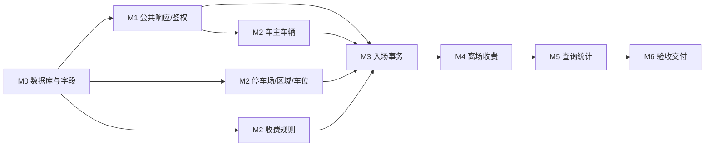

# 智能停车场管理系统：开发排期与三人分工

> 项目：`smart-parking-system`；集成分支：`dev`；适用人数：3 人
> 编写日期：2026-10-26；本次修订：2026-11-16
> 状态：**执行草案，待三名成员确认**。这里的任务分配是执行建议，不把已合并的代码等同于已验收的系统。

## 0. 依据、现状与使用方法

**直接交给 AI 开工的入口**：[工程总契约](implementation/00_工程实施规格.md) → [接口与数据契约](implementation/01_接口与数据契约.md) → [三人成员任务书](implementation/02_三人成员任务书.md) → [联调测试矩阵](implementation/03_联调测试矩阵.md)。四份文档是待三人确认的目标规格，并非已实现功能；确认后同一版本发给三个组员和各自 AI，避免只读本分工表而自行猜接口。

设计与验收口径依次查阅[需求分析](智能停车场管理系统_需求分析.md)、[ER 图](database-design/ER图.md)、[数据字典](database-design/数据字典.md)、[建表脚本](../database/01_schema.sql)；Git 操作细节见[仓库使用与后续开发指南](智能停车场管理系统_仓库使用与后续开发指南.md)。本文件安排任务、依赖、交接和验收；具体接口和工程决策以四份实施文档为准。发生冲突时先由三人确认并同步修改依据，再改代码。

截至 2026-11-18，需求与数据库设计相关 PR 已合入 `dev`；[PR #5](https://github.com/Niannya/smart-parking-system/pull/5) 已合入建表和演示数据；[PR #6](https://github.com/Niannya/smart-parking-system/pull/6) 已合入停车区域接口、页面和成员 2 指南，但统一鉴权与接口契约仍待收口。其他功能的完成情况不得从分支名或页面截图推断，以本文件的验收记录为准。

任务状态只用：`未开始`、`进行中`、`待审查`、`已合并待验收`、`已验收`、`阻塞`。负责人更新状态，审查人核对证据；没有证据的任务不标为“已验收”。每个任务编号是 PR、讨论和验收的共同索引。

## 1. 分工与文件边界

| 人员 | 负责的完整业务链 | 主要交付 | 审查职责 |
| --- | --- | --- | --- |
| 成员 1：廖展鸿（组长） | 数据库与公共基础、账号登录/启停和角色权限、停车场管理、统计首页、集成与发布 | SQL 与设计文档；公共响应/异常；认证、账号状态与路由；停车场接口和页面；统计接口和页面 | 审查成员 2、3 的跨停车场归属、权限、事务和数据库变更；组织里程碑验收 |
| 成员 2：姓名待确认 | 车主车辆绑定、停车区域、停车位、自动分配与车辆入场 | 对应接口、页面、测试；入场记录创建及车位占用事务 | 审查成员 1 的车辆身份契约、成员 3 的离场车位释放 |
| 成员 3：姓名待确认 | 收费规则、计费、车辆离场与支付、管理员和车主记录查询 | 对应接口、页面、测试；离场结算事务 | 审查成员 2 的入场规则绑定、成员 1 的收入统计 |

继续沿用既有业务分工，**车主车辆绑定仍由成员 2 负责**；上一轮讨论中的“移给组长”只是均衡工作的建议，未得到全组确认前不擅自变更。成员 1 提供登录态中的用户 ID 与角色，成员 2 基于该身份实现“只能管理本人车辆”。

公共文件归属如下，避免三人并行修改同一处：

| 文件或契约 | 主维护人 | 其他人如何提出变更 |
| --- | --- | --- |
| `database/**`、需求和数据字典 | 成员 1；三人共同审查 | 在 PR 写明字段、约束、迁移影响，未经评审不直接改已合并表结构 |
| `backend/.../common/**`、认证/权限配置、统一错误码 | 成员 1 | 提交所需错误码和响应示例，由成员 1 汇总；不再各自增加第二套全局异常处理 |
| `frontend/src/App.vue`、路由、通用 HTTP 客户端、登录状态 | 成员 1 | 各自新增模块页面和 API 文件；由成员 1 接入菜单与路由 |
| 停车区域、车位、车辆与入场代码 | 成员 2 | 成员 1、3 通过 PR 审查跨模块接口 |
| 收费规则、离场、支付和记录查询代码 | 成员 3 | 成员 1、2 通过 PR 审查跨模块接口 |
| `parking_record` 数据契约 | 三人先冻结；成员 2 写入场，成员 3 写离场与查询 | 在各自 Mapper/Service 增量实现；共享实体字段更改先更新契约，不同时抢改同一文件 |

PR #6 中的临时 `ApiResult`、异常处理、停车场下拉接口和 `App.vue` 直挂页面，属于**联调过渡物**。成员 1 在公共基础和路由 PR 中统一替换；PR #6 的业务完成状态不能代替管理员鉴权验收。

## 2. 范围与工作量口径

以需求分析中标为“必须”的功能和第 12 节验收标准为交付边界。小组不按商业产品迭代排“第一版／第二版”；通过 M6 即是本课程设计的目标交付。

下表的点数仅用于比较相对工作量，**不是天数、成绩或强制工时**：1 点＝小任务，2 点＝中等任务，3 点＝跨接口或事务的大任务。已做的工作仍计入任务总量；组员确认后可调整点数，但必须同步调整任务表和负载表。

| 成员 | M1 | M2 | M3 | M4 | M5 | M6 | 计划点数 |
| --- | ---: | ---: | ---: | ---: | ---: | ---: | ---: |
| 成员 1 | 8 | 2 | 0 | 0 | 2 | 2 | 14 |
| 成员 2 | 0 | 7 | 7 | 0 | 0 | 0 | 14 |
| 成员 3 | 0 | 5 | 0 | 7 | 4 | 0 | 16 |

M0 的既有设计和数据库工作、三人互审、课程报告与演示准备不计点；它们仍必须完成。成员 3 的任务总量略高，M3 可提前做离场接口草案和计费测试，不能等入场全部结束才开工。

## 3. 里程碑总表

| 里程碑 | 可演示的目标 | 进入条件 | 出口闸口与主要证据 | 主签收人 |
| --- | --- | --- | --- | --- |
| **M0 基线确认** | 三人能从同一需求、数据库结构和演示数据开工 | 需求分析、ER 图、数据字典及 SQL 可查 | 三人确认范围与接口契约；空库初始化验证；证据见[验收记录](milestones/停车场项目_里程碑验收记录.md) | 三人共同 |
| **M1 公共基础** | 两类账号可登录，管理接口按角色限制；前端有统一入口 | M0 的字段和角色口径冻结 | 统一响应和异常；ADMIN/OWNER/未登录访问结果；前后端构建与测试记录 | 成员 2、3 审查 |
| **M2 入场前置资源** | 两个停车场分别有区域、车位、车主车辆与收费规则 | M0 数据库；接口开发可与 M1 并行，出口依赖 M1 鉴权 | 按停车场隔离；状态约束；规则唯一有效；车辆归属；PR #6 的临时代码收口 | 成员 1 主审 |
| **M3 车辆入场** | 指定停车场自动分配车位并生成在场记录 | M1、M2 全部出口通过 | 跨场隔离、重复车牌/无位拒绝、规则绑定、入场事务及回滚证据 | 成员 1、3 |
| **M4 离场收费** | 费用预览、确认支付、记录完成并释放车位 | M3 已验收；M2 收费规则可用 | 免费/跨日计费、不同停车场规则、离场事务及回滚证据 | 成员 1、2 |
| **M5 查询与统计** | 管理员、车主各看其权限内记录；首页统计准确 | M3、M4 的数据链可用 | 车主越权拒绝、查询过滤、统计对账、页面联调 | 三人共同 |
| **M6 交付** | 从登录到入场、离场、查询的完整演示 | M0–M5 无未关闭必做项 | 两台电脑复现、测试与演示证据、课程报告、`dev → main` PR | 三人共同 |

闸口指**能否签收该里程碑**，不是禁止下游提前写不依赖前置的代码。例如成员 3 可在 M1 阶段写纯计费函数，但 M4 不会在车辆入场契约完成前签收。

## 4. 任务清单、依赖与交接

### M0 基线确认（当前收口）

| ID | 负责人；审查人 | 任务与交付物 | 前置 | 验收点 | 当前状态 |
| --- | --- | --- | --- | --- | --- |
| M0-01 | 成员 1；成员 2、3 | 需求分析、ER 图、数据字典与范围确认 | — | 三人确认两类角色、多停车场、收费及权限边界，待决项有结论 | 文档已合并，签字待确认 |
| M0-02 | 成员 1；成员 2、3 | `01_schema.sql`、`02_seed_data.sql`、初始化说明 | M0-01 | 空库执行成功；8 张核心表、2 个停车场、每场 20 个车位；三人各自记录环境差异 | PR #5 已合并，环境复现待验收 |
| M0-03 | 成员 1 起草；全组确认 | [实施四文档](implementation/00_工程实施规格.md)：路径、请求/响应、错误码、状态字面值、当前用户 ID 与角色、模块与文件归属 | M0-01、M0-02 | 成员 2 的入场和成员 3 的离场可以按同一字段命名开发 | 草案已写，待三人确认 |

### M1 公共基础（成员 1 主线，共 8 点）

| ID | 负责人 | 点 | 前置；允许提前做的部分 | 交付与可检验结果 |
| --- | --- | ---: | --- | --- |
| M1-01 | 成员 1 | 1 | M0-03 | 固定响应包、错误码、鉴权失败格式及接口文档；三人认可样例 |
| M1-02 | 成员 1 | 2 | M1-01 | 一套公共响应/异常处理；错误请求不泄露 SQL、密码或堆栈；PR #6 临时类替换方案 |
| M1-03 | 成员 1 | 3 | M0-02、M1-02 | 注册仅能创建 OWNER；ADMIN/OWNER 登录与退出及管理员启停账号；停用后旧会话失效；后端角色校验；未登录和越权请求被拒 |
| M1-04 | 成员 1 | 2 | M1-01；页面骨架可先做 | 前端路由、菜单、登录态和 HTTP 客户端统一；组员只提交各自页面组件，不再直改 `App.vue` |

### M2 入场前置资源（三线并行，共 14 点）

| ID | 负责人 | 点 | 前置；允许提前做的部分 | 交付与可检验结果 |
| --- | --- | ---: | --- | --- |
| M2-01 | 成员 1 | 2 | M1-03；SQL 和页面可先写 | 停车场增改、启停及页面；有在场车辆时不得停用；停用场不接收新入场 |
| M2-02 | 成员 2 | 2 | M0-02；最终签收依赖 M1-02、M1-03、M2-01 | 区域查询、增改、启停、删除及页面；按停车场隔离；已合入的 PR #6 仍须完成临时代码收口与鉴权验收 |
| M2-03 | 成员 2 | 3 | M2-02 的区域 ID 与状态契约；后端可用演示区域先开发 | 车位增改、筛选、启停与页面；占用车位不得停用/删除；同一区域编号唯一 |
| M2-04 | 成员 2 | 2 | M1-03 的当前用户 ID；模型可先开发 | 车主绑定/停用本人车辆和页面；车牌全局唯一；修改请求 ID 也不能越权 |
| M2-05 | 成员 3 | 3 | M0-02、M0-03；独立于车位开发 | 按停车场维护当前和历史收费规则；同场最多一条有效规则；提供按停车场取当前规则的接口 |
| M2-06 | 成员 3 | 2 | 收费规则字段已冻结；纯函数与用例可立即写 | 费用计算函数及测试：30 分钟免费、超时向上取整、每连续 24 小时封顶、26 小时示例为 60 元 |

### M3 入场闭环（成员 2 主线，共 7 点）

| ID | 负责人 | 点 | 前置 | 交付与可检验结果 |
| --- | --- | ---: | --- | --- |
| M3-01 | 成员 2 | 2 | M2-01、M2-02、M2-03 | 只在所选启用停车场的启用区域中，按区域编号/车位编号排序选取空闲车位；无位时明确拒绝 |
| M3-02 | 成员 2 | 3 | M1-03、M2-04、M2-05、M3-01 | 一个事务内校验重复车牌、锁定/占用车位、创建 `parking_record`，绑定入场时的 `fee_rule_id`，已绑定车牌关联车辆；失败全回滚 |
| M3-03 | 成员 2 | 2 | M3-02 | 入场页面、API 与测试；展示车位和入场时间；两人并发抢最后一个车位时最多一个成功 |

### M4 离场收费（成员 3 主线，共 7 点）

| ID | 负责人 | 点 | 前置 | 交付与可检验结果 |
| --- | --- | ---: | --- | --- |
| M4-01 | 成员 3 | 2 | M2-06、M3-02 | 用在场记录**已绑定的规则**计算费用预览，不取停车场后来换上的规则；金额为两位小数 |
| M4-02 | 成员 3 | 3 | M4-01、M1-03 | 确认模拟支付后，在一个事务中新增 `payment_record`、完成 `parking_record`、释放车位；重复离场不能重复收费；免费放行须有原因 |
| M4-03 | 成员 3 | 2 | M4-02 | 离场页面及测试；找不到在场记录、未确认支付、事务任一步失败都有正确反馈且数据不半成功 |

### M5 查询与统计（成员 1、3 并行，共 6 点）

| ID | 负责人 | 点 | 前置 | 交付与可检验结果 |
| --- | --- | ---: | --- | --- |
| M5-01 | 成员 3 | 2 | M3-02、M4-02 | 管理员在场/历史记录及收费详情查询；按停车场、车牌、时间、状态过滤不串场 |
| M5-02 | 成员 3 | 2 | M1-03、M2-04、M5-01 | 车主只能查看登录账号名下车辆对应的当前/历史记录；服务端根据身份过滤，不信任前端传入的 owner ID |
| M5-03 | 成员 1 | 2 | M2-03、M3-02、M4-02 | 全部/指定停车场车位数、占用率、当日进出量、收入统计与页面；与底层记录对账 |

### M6 联调与课程交付（全组；成员 1 集成计 2 点）

| ID | 负责人 | 前置 | 交付与可检验结果 |
| --- | --- | --- | --- |
| M6-01 | 三人；组长组织 | M0–M5 必做项 | 按需求分析 §12 做完整回归：两停车场、管理员/车主、入场/离场/查询、拒绝与回滚；证据填入验收记录 |
| M6-02 | 成员 1 集成；成员 2、3 审查 | M6-01 | 清理临时接口与样例代码；确认无真实密码和生成目录；前后端构建；至少两台组员电脑按说明重新搭建 |
| M6-03 | 三人 | M6-02 | 各自完成模块说明、测试证据和答辩内容；组长整理课程报告；稳定后由非作者审查 `dev → main` PR |

## 5. 关键路径、冻结点和并行开工

**关键路径**为“数据库契约 → 资源/规则准备 → 入场事务 → 离场事务 → 查询统计 → 全流程验收”。最易卡住的是 `M3-02`：它同时消费车位、车辆、收费规则和鉴权四方契约。组长在 M0-03 就冻结 `parking_record` 的停车场、车位、车辆、规则、管理员和时间字段；成员 2、3 在 M3 开工前各用一条样例数据互相核对。

| 冻结点 | 交付者 | 消费者 | 未冻结前可先做什么 |
| --- | --- | --- | --- |
| F1 数据库字段与状态字面值（含 `ACTIVE`、`DISABLED`、`FREE`、`OCCUPIED`、`PARKING`） | 成员 1，三人复核 | 所有业务模块 | 页面草图、纯计费函数和测试用例 |
| F2 响应/错误码/当前用户身份与角色 | 成员 1 | 成员 2、3 的 Controller 与前端 API | 各自 Service、Mapper、独立页面组件 |
| F3 停车场、区域、车位及可分配条件 | 成员 1、2 | M3 入场与 M5 统计 | 成员 3 的收费规则、费用计算 |
| F4 当前收费规则选择与入场 `fee_rule_id` 绑定 | 成员 3，成员 2 确认 | M3 入场、M4 离场 | 成员 2 的车位分配；成员 3 的计费测试 |
| F5 入场记录字段及状态迁移 | 成员 2，成员 3 确认 | M4 离场、M5 查询 | 成员 3 的离场页面和费用预览草案 |

冻结点变更需在 PR 描述列出旧/新字段、受影响任务及复测范围，由消费者确认。未合并的分支可以继续准备独立代码，但**不能把依赖别人的未合并分支当作 `dev` 的稳定接口**。

## 6. PR 顺序与交接规则

1. PR #6 已合入：成员 2 依新接口契约处理区域状态规则与错误码；成员 1 明确临时公共类及 `App.vue` 的替换 PR。PR #6 的合入只代表区域代码进入 `dev`，不代表 M2 鉴权闸口通过。
2. 成员 1 把公共响应、鉴权、前端路由、停车场分别做成可审的小 PR；成员 2 的车位与成员 3 的收费规则可并行，不必等待所有页面完成。
3. 收费规则的“取当前规则”契约合入后，成员 2 提交入场 PR；入场 PR 合入并验证后，成员 3 提交离场 PR。查询与统计最后联调。
4. 每个 PR 目标为 `dev`，提交信息用中文；写明任务 ID、依赖 PR、数据库变化、测试命令及结果、正常/异常用例、截图或日志位置。作者不得独自审查和合并自己的 PR。
5. 合并前从最新 `dev` 同步分支、解决冲突并重跑受影响的测试；合并后在 `dev` 再执行一次最小烟测。`main` 只接收 M6 已验收的稳定成果。

建议审查人：成员 1 的 PR 由成员 2 或 3 主审；成员 2 的 PR 由成员 1 主审、成员 3 检查收费规则绑定；成员 3 的 PR 由成员 1 主审、成员 2 检查车位释放。审查人依据[验收记录](milestones/停车场项目_里程碑验收记录.md)给出“通过／退回”和具体缺口。

## 7. 风险、超期取舍与不可砍项

| 风险/前置信号 | 负责人 | 处理 |
| --- | --- | --- |
| PR #6 的临时公共类与 M1 重名或响应格式冲突 | 成员 1、2 | 成员 1 统一替换并回归区域接口；公共类只保留一套 |
| 成员 2 等收费规则或身份接口，入场迟迟不能完成 | 成员 1、3 | M0-03/F2/F4 先给稳定契约；成员 2 先做车位分配与事务测试，联调再接真实接口 |
| 停用区域、车位与车辆入场并发造成状态不一致 | 成员 2；成员 1 审查 | 用数据库约束、锁或条件更新保证与入场事务一致；必须有并发或可复现的冲突测试 |
| 离场与支付中途失败产生半完成记录 | 成员 3；成员 2 审查 | 三表同事务，注入失败验证回滚；重复提交用唯一约束和状态条件防重 |
| 组长公共基础与集成工作叠加 | 全组 | 成员 2、3 各自负责模块文档、测试和 PR 描述；组长只做跨模块集成，不替写全部页面 |

若进度不足，按顺序延后需求分析中标为“建议／可选”的内容：手动选位、图表趋势、查询分页、Excel 导出及界面润色。**不可砍**：多停车场隔离、管理员/车主权限、空位自动分配、入场/离场事务、入场绑定收费规则、正确计费、记录与统计、完整演示。任何改变“必须”功能范围的决定，先由三人共同确认并同步需求分析，不能只在本表删行。

## 8. 验收节奏与进度台账

每次同步只报四项：已完成任务 ID、下一步任务 ID、阻塞及其负责人、可打开的 PR/测试证据。里程碑由非作者依[验收记录](milestones/停车场项目_里程碑验收记录.md)复核；空白即未验收，不写“基本通过”。缺口写明负责人和补验任务 ID，修复后重新签收。

| 任务组 | 负责人 | 当前可确认状态 | 下一动作 |
| --- | --- | --- | --- |
| 需求与数据库设计 | 成员 1；全组审查 | 文档相关 PR 已合并；三人签字未见记录 | M0-01 确认 |
| 建表和演示数据 | 成员 1 | PR #5 已合并；各组员本机复现未见记录 | M0-02 环境验证 |
| 公共接口契约与权限 | 成员 1 | 未见已合并实现 | M0-03、M1-01～04 |
| 停车区域 | 成员 2 | PR #6 已合并、业务验收未完成 | 依接口契约处理旧错误码、接统一鉴权并复测 |
| 停车位、车主车辆、入场 | 成员 2 | 未见已合并实现 | 按 M2、M3 依赖推进 |
| 收费规则、离场、记录 | 成员 3 | 未见已合并实现 | 先做 M2-05/06 |
| 统计与交付 | 成员 1、全组 | 未到验收阶段 | 待 M3、M4 数据链完成 |

## 9. 分工确认

| 人员 | 姓名 | 确认日期 | 对职责、点数或依赖的修改意见 |
| --- | --- | --- | --- |
| 成员 1 | 廖展鸿 |  |  |
| 成员 2 |  |  |  |
| 成员 3 |  |  |  |

确认后若改变负责人与任务点数，需同步更新第 1、2、4、8 节及验收记录，不只在群聊中口头变更。
